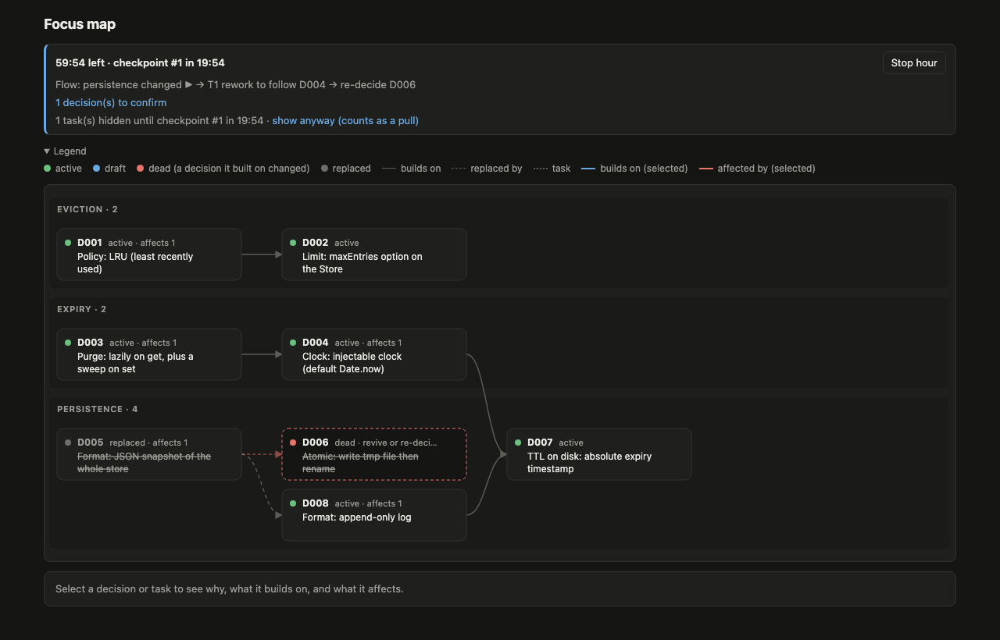
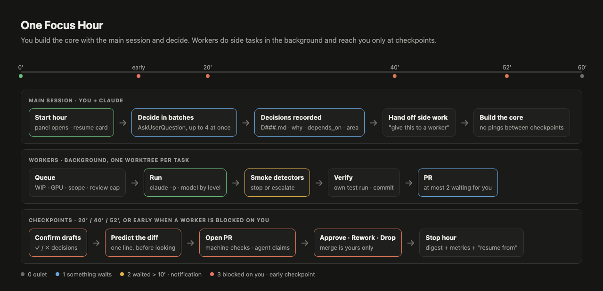
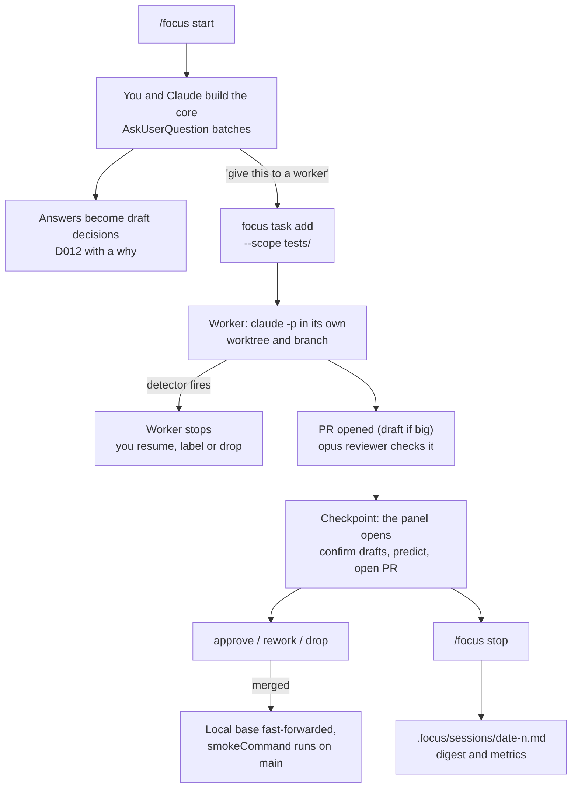
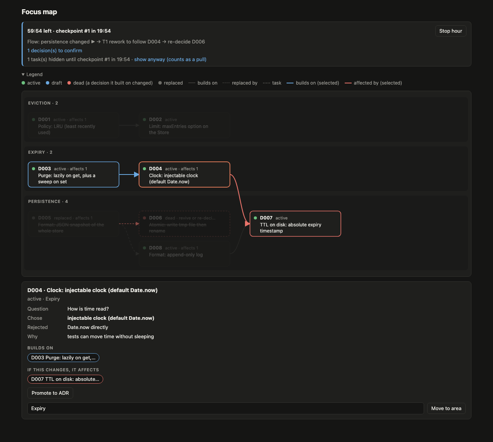
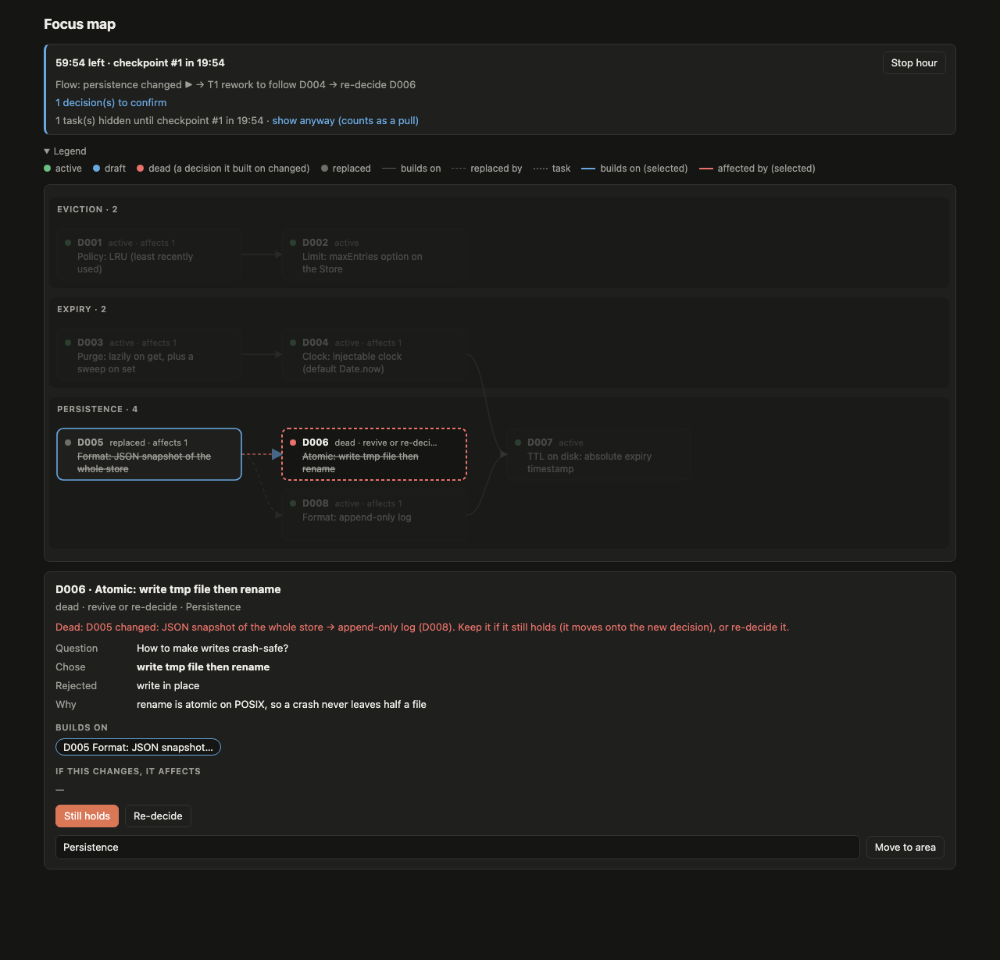
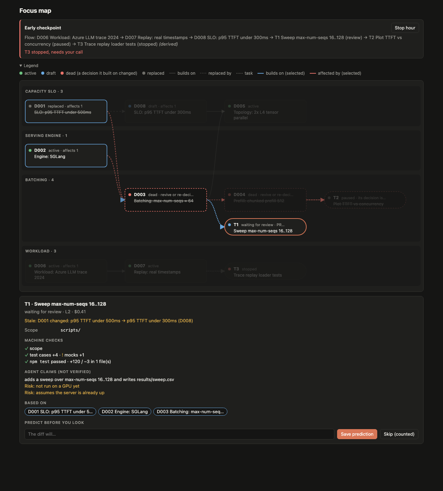
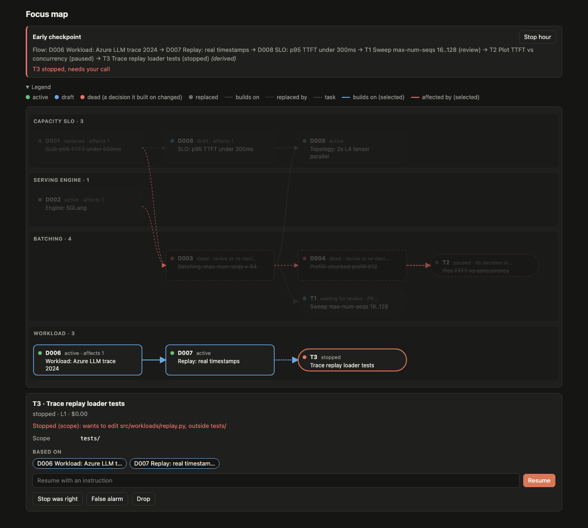
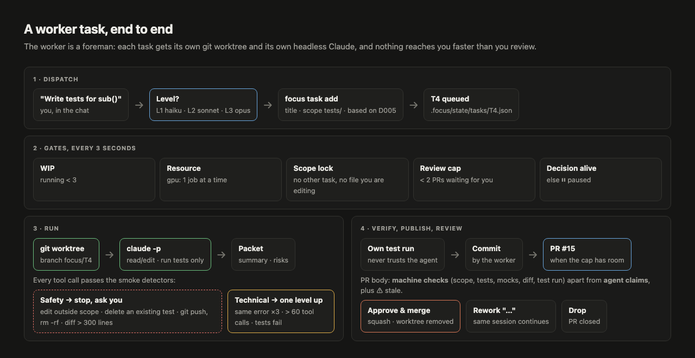
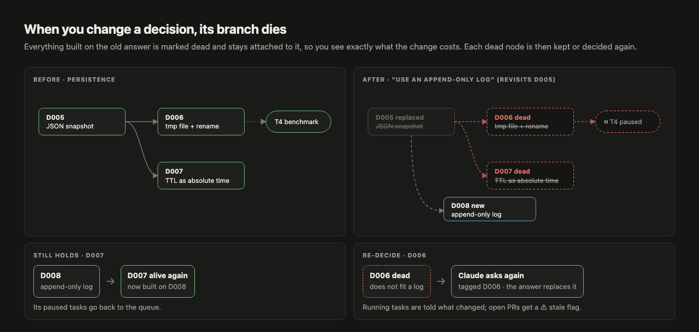
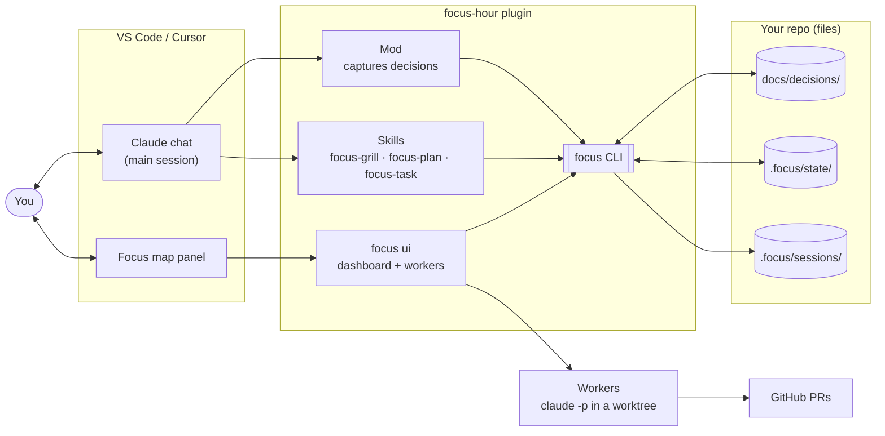

# focus-hour

**Build the core of your work with Claude Code for one hour while background workers do the side tasks and open PRs at your review pace, and every decision you make is logged with a plain-language why.**

[](https://github.com/hoangphu7122002/focus-hour/commits/main)



## What and why

Focus Hour is a Claude Code plugin for one person working in one repo. You work the core task with the main Claude session and make the decisions. Side tasks (tests, docs, scripts, verification) go to background workers. Each worker runs `claude -p` in its own git worktree and opens a real PR. Workers reach you only at checkpoints, so you are not interrupted all hour.

Every answer you give to a question becomes a decision record with a plain-language *why*. Decisions form a graph: change one and you see what it builds on and what it affects.

It is not an autonomous agent. Workers never push to the base branch or merge; a merge happens only when you press the button. Design and principles: [SPEC.md](SPEC.md).



## Features

| Feature | What you get |
|---|---|
| **Decision log** | Answers to `AskUserQuestion` become draft decisions (`docs/decisions/D###.md`) with a *why*, a feature area and links to the decisions they depend on. |
| **Impact graph** | Select a decision to see what it builds on (blue) and what it affects (red). Change one and its branch is marked dead until each node is kept or decided again. |
| **Background workers** | `focus task add` queues a side task. Each runs in its own worktree and branch; overlapping scopes queue instead of colliding. |
| **Review-paced PRs** | At most `reviewCap` PRs wait on you (SPEC default 2). Big PRs open as drafts; an opus reviewer clears them or sends blockers back. Your GitHub comments become reworks. |
| **Smoke detectors** | A detector can stop a worker. You resume it, label the stop, or drop the task. The review packet keeps machine checks apart from agent claims. |
| **Feature planning** | `/focus-plan docs/roadmap.md#F2` splits a roadmap feature into small ordered tasks. |
| **Grilling** | `/focus-grill` asks decision questions in batches of up to 4. |
| **Focus map panel** | A VS Code / Cursor view with a status-bar timer. It opens itself at checkpoints. Or run `focus ui` for a dashboard at http://127.0.0.1:7777. |
| **Session digest** | `/focus stop` writes `.focus/sessions/<date>-<n>.md` with a digest and metrics. `focus report` compares focus and observe sessions. |

## Quickstart

Needs Claude Code 2.1.288 or newer (mods), Node 18 or newer and git. `gh` must be logged in for real PRs.

```bash
# 1. The Claude Code plugin (CLI, skills, mod)
claude plugin marketplace add hoangphu7122002/focus-hour
claude plugin install focus-hour@focus-hour

# 2. The Focus map panel for VS Code / Cursor (optional, recommended)
gh release download --repo hoangphu7122002/focus-hour --pattern '*.vsix'   # or take vscode/*.vsix from the repo
cursor --install-extension focus-hour-vscode-*.vsix                        # or: code --install-extension …

# 3. The `focus` command in your shell (optional): the installed plugin's CLI
alias focus='node "$(ls -d ~/.claude/plugins/cache/*/focus-hour/*/ | sort -V | tail -1)bin/focus.mjs"'
```

Restart Claude Code and the editor. Update later with `claude plugin update focus-hour@focus-hour`.

Then, once per repo:

```bash
cd <repo> && focus init     # writes .focus/config.json (test command, base branch), gitignores .focus/state/
```

`focus init` also detects the stack's permission preset and prints `focus doctor` (what the repo still misses). Open the repo in VS Code / Cursor and the panel starts the dashboard and workers. Without the editor, run `focus ui` in one terminal and `claude` in another. Start with `/focus start`.

## How it works



<details><summary><b>Each hour: commands</b></summary>

| When | What |
|---|---|
| start | `/focus start` (or the pane's *Start hour*); `--observe` for a baseline session, `--difficulty 1-5` |
| deciding | ask for options; answers to AskUserQuestion become draft decisions (`/focus-grill` grills in batches) |
| side work | "give this to a worker" runs the `focus-task` skill, which runs `focus task add …` |
| a feature | `/focus-plan docs/roadmap.md#F2` makes tasks with order (`--after`); the next feature is offered when it merges |
| big PRs | opened as drafts; an opus reviewer clears them or sends blockers back; your GitHub comments become reworks |
| after merges | your local main is fast-forwarded to origin (`autoSyncBase`, safe only; else a "run git pull" hint); `smokeCommand` runs on main; `focus compare --repo a --repo b` for numbers |
| checkpoints | the pane opens; confirm drafts, review decisions marked ⚠, predict, open the PR, then approve / rework / drop |
| end | `/focus stop` writes `.focus/sessions/<date>-<n>.md` (digest and metrics); `focus report` compares focus vs observe |

`focus help` lists every CLI command (`focus decision`, `focus task`, `focus approve`, `focus doctor`, `focus lesson`, `focus compare`, `focus worker`, `focus ui` and more).

Edit `.focus/config.json` for anything that differs from the defaults (`focus defaults` prints them), e.g. `"resources": { "gpu": 1 }`, `"language": { "chat": "vi" }`, `"roadmap": "docs/roadmap.md"`, `"smokeCommand": "make demo"`, or `"slots"` for per-task ports and DBs.

**What belongs where.** The plugin holds code and generic rules; the repo holds only its own data (`.focus/config.json`, `.focus/lessons.md`, `.focus/sessions/`, `docs/decisions/`, its roadmap). A rule for this repo is a lesson (`focus lesson "[backend/] …"`); an idea for Focus Hour itself is `focus plugin-note "…"`, kept in `~/.focus-hour/`, never in the repo. See [SPEC.md section 3](SPEC.md#3-packaging).

**Scoped with bach-workflow?** Run `/bach:demo-scope`, then `focus init` in the repo: it picks up the roadmap, the review lessons and `stack.toml`. Build each feature with `/focus-plan <roadmap>#F<n>` instead of `/bach:pr-team` (SPEC section 7d).

**VS Code / Cursor panel.** A *Focus Hour* icon in the activity bar opens the **Focus map** view. In a repo with `.focus/config.json` it starts `focus ui` (dashboard and workers) by itself, mirrors the timer in the status bar, and reveals the map at checkpoints. Settings: `focusHour.cliPath` (empty means the installed plugin), `focusHour.port`, `focusHour.autoStart`.

**Dashboard.** `focus ui` serves an Agent-map-style page at http://127.0.0.1:7777. Open it in VS Code with *Cmd+Shift+P, Simple Browser: Show* and dock it beside the chat (macOS notifications stand in for the pane's toasts). In a terminal session, `/focus` opens the same view as a pane.

</details>

<details><summary><b>More screenshots</b></summary>

| Select a decision: what it builds on (blue) and what it affects (red), across lanes | Change a decision: its branch dies until each node is kept or decided again |
|---|---|
|  |  |
| **Review a task**: machine checks apart from agent claims; predict before opening the PR | **A smoke detector stopped a worker**: resume it, label the stop, or drop it |
|  |  |

A worker task, end to end, and what a change of mind does:




Sidebar and light theme: [06-sidebar.png](docs/images/06-sidebar.png), [07-light.png](docs/images/07-light.png). Diagrams are generated from [docs/images/flows.html](docs/images/flows.html).

</details>

## Architecture

Three thin front ends over one CLI. The CLI keeps everything as files in your repo, and the chat, the panel and the workers never write those files themselves. Diagrams: [docs/ARCHITECTURE.md](docs/ARCHITECTURE.md).



| Layer | Stack |
|---|---|
| CLI and logic | Node 18+ ES modules, no dependencies: `bin/focus.mjs`, `lib/*.mjs` |
| Claude Code | Plugin with a mod (`hooks/register.tsx`) and three skills in `skills/` |
| Dashboard | `ui/index.html` and `ui/graph.js`, served by `focus ui` |
| Editor | VS Code / Cursor extension in `vscode/` |
| Workers | `claude -p` per task in a git worktree; prompts in `prompts/` |
| Storage | Files in your repo: committed decisions and digests, gitignored `.focus/state/` |

## Project layout

| Path | What's there |
|---|---|
| [`bin/`](bin) | The `focus` CLI entry point |
| [`lib/`](lib) | CLI logic: decisions, tasks, workers, review, session, GitHub, config |
| [`skills/`](skills) | `focus-grill`, `focus-plan`, `focus-task` |
| [`hooks/`](hooks) | The mod that captures decisions and adds the workflow to the prompt |
| [`prompts/`](prompts) | Worker and reviewer prompts |
| [`ui/`](ui) | Dashboard page and graph |
| [`vscode/`](vscode) | The Focus map extension (with a built `.vsix`) |
| [`test/`](test), [`tests/`](tests) | CLI unit tests, mod tests |
| [`scripts/release.sh`](scripts/release.sh) | Release script |
| [`SPEC.md`](SPEC.md), [`docs/`](docs) | Design, architecture, images |

## Develop

```bash
npm test                     # CLI unit tests + mod tests (claude plugin test)
claude plugin validate .
scripts/release.sh 0.3.0 "what changed"   # bump, test, commit, push, GitHub release, update local install
```

## License

No license has been chosen yet, so all rights are reserved by default.
